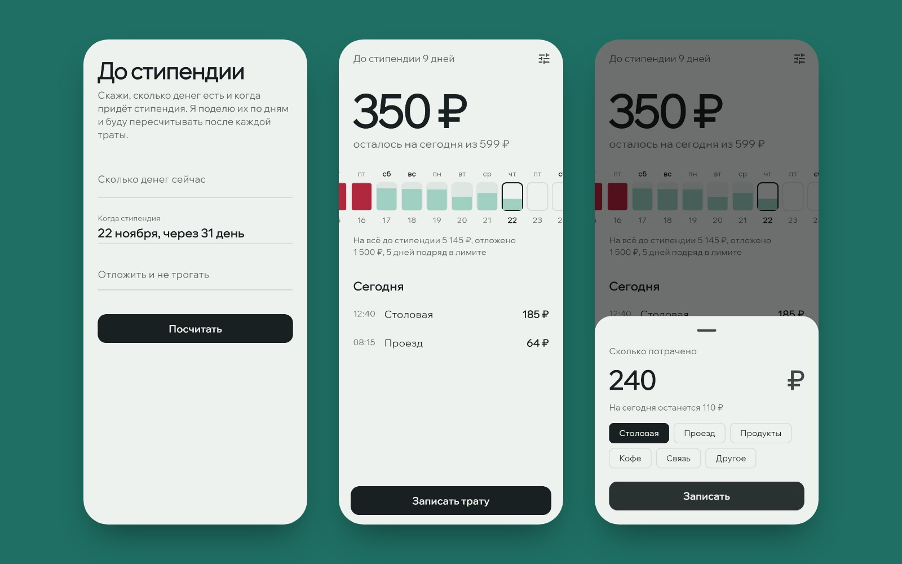

# До стипендии

Приложение для iPhone, которое отвечает на один вопрос: **сколько можно потратить
сегодня**, чтобы деньги дожили до стипендии.

Вводишь, сколько денег сейчас и когда придёт стипендия. Приложение делит деньги
по дням и пересчитывает лимит после каждой траты: перерасходовал вчера — сегодня
чуть меньше, сэкономил — следующие дни чуть свободнее.

**Веб-версия, чтобы потрогать без iPhone:** https://ex3ittt.github.io/do-stipendii/



## Что умеет

- Показывает крупно, сколько ещё можно потратить сегодня. Число плавно
  досчитывается до нового значения после каждой траты.
- **Лента дней до стипендии.** Каждый прошедший день заполнен на ту долю лимита,
  которую ты потратил: зелёный — уложился, красный — перерасход. Сегодня
  обведено, будущие дни пустые.
- Пока вводишь сумму, сразу пишет, сколько на сегодня останется или насколько
  выйдешь за лимит.
- **Отложенные деньги**, например на проездной, не попадают в дневной лимит.
- Считает, сколько дней подряд ты укладываешься в лимит.
- Когда приходит стипендия, предлагает начать новый период.
- Светлая и тёмная тема, всё на русском, данные хранятся только на телефоне.

## Как считается лимит

```
лимит на день = (деньги − отложено − потрачено до сегодня) / дней до стипендии
```

Лимит пересчитывается каждое утро от того, что осталось. Поэтому ошибка одного
дня размазывается по всем оставшимся дням, а не копится к концу месяца.
Последний день получает всё, что осталось.

Деньги хранятся в копейках (`int`), а не в рублях с плавающей точкой. На экране
дневной лимит округляется вниз до рубля: «599 ₽», а не «599,33 ₽». Сама математика
при этом остаётся точной. «День» определяется по календарю, поэтому трата в 23:59
относится к своему дню, а не к следующему.

## Устройство

```
lib/
  domain/
    budget.dart   период, траты, лимит на день, лента, серия дней — чистый Dart
    money.dart    копейки, «1 250 ₽», разбор «1 250,50»
    store.dart    сохранение в shared_preferences
  ui/
    home.dart, setup.dart, spend_sheet.dart, strip.dart
    palette.dart  цвета (с купюры в 1000 ₽) и тема
test/
  budget_test.dart  13 тестов на расчёты
  app_test.dart     3 теста интерфейса: первый запуск, траты, конец периода
```

## Запуск

```bash
flutter pub get
flutter test
flutter run            # на подключённом iPhone или в симуляторе
flutter run -d chrome  # веб-версия
```

## Стек

Flutter, Dart, shared_preferences, intl, шрифт Wix Madefor Display. GitHub
Actions прогоняет анализатор и тесты, собирает приложение под iOS и выкладывает
веб-версию на GitHub Pages.
